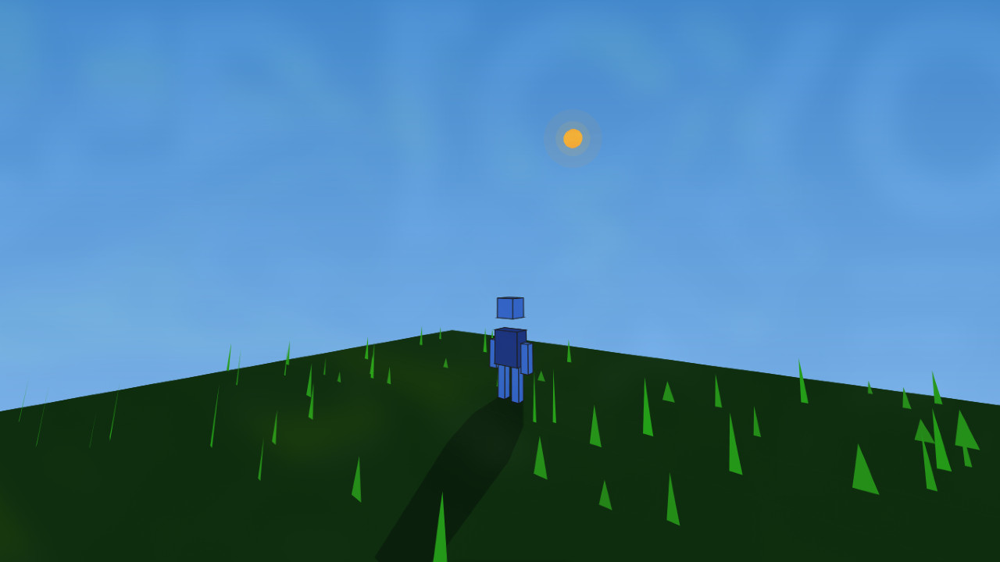
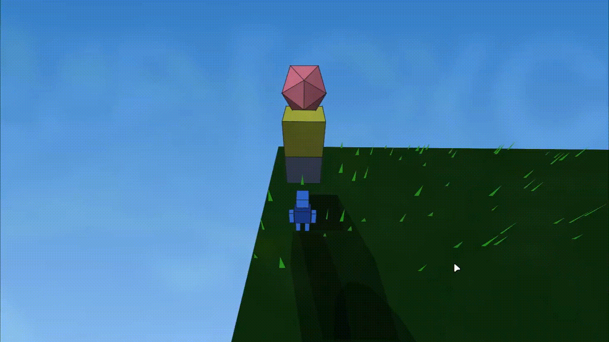

# Luen Snbx Engine
- A lightweight 3D engine written completely from scratch using Lua(Doesn't use C++ or graphics libraries such as OpenGL) instead it uses its own own rendering logic with Cairo for drawing.
- also its pronounced Luen Sandbox Engine...!
- runs completely on on your CPU's single thread so might struggle on low end CPUs
**IMPORTANT!** This project only runs on Linux or on windows if you are willing to deal with WSL(haven't tested on windows)
## Features

- **Custom 3D Rendering** – A 3D renderer implemented in Lua, using perspective projection.
- **Player Movement** – Move around the world using WASD and jump using Space.
- **Camera Controls** – Rotate the camera using the mouse and adjust zoom using I and O.
- **Physics and Collisions** – Gravity and collision handling for boxes, spheres, and the player.
- **Creator Panel** – Spawn cubes and spheres directly into the world.
- **Spatial Audio** – Sound volume and stereo panning change based on the player's distance and position relative to the sound source.

