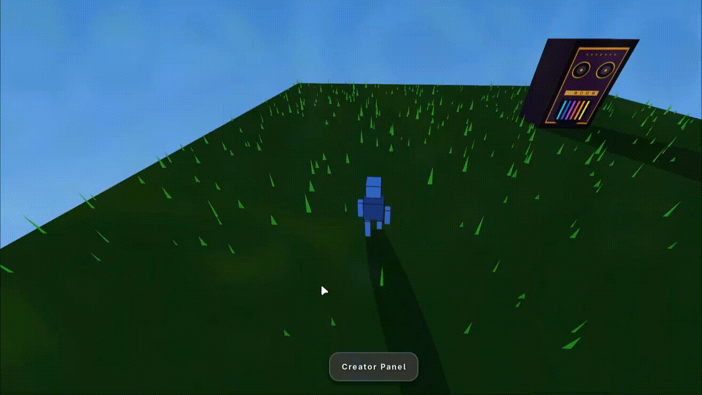

# Luen Snbx Engine
- A lightweight 3D engine written completely from scratch using Lua(Doesn't use C++ or graphics libraries such as OpenGL) instead it uses its own own rendering logic with Cairo for drawing.
- also its pronounced Luen Sandbox Engine...!
- runs completely on on your CPU's single thread so might struggle on low end CPUs
  
**IMPORTANT!** This project only runs on Linux or on windows if you are willing to deal with WSL(haven't tested on windows)
## Features

- **Custom 3D Rendering** – A 3D renderer implemented in Lua, using perspective projection.
- **Player Movement** – Move around the world using WASD and jump using Space.
- **Camera Controls** – Rotate the camera using the mouse and adjust zoom using I and O.
- **Physics and Collisions** – Gravity and collision handling for boxes, spheres, and the player.
- **Creator Panel** – Spawn cubes and spheres directly into the world.
- **Spatial Audio** – Sound volume and stereo panning change based on the player's distance and position relative to the sound source.




## Installation

### Requirements

- Linux
- Lua 5.4
- GTK 3
- LGI (Lua bindings for GTK and GStreamer)
- Cairo
- GStreamer

### 1. Install dependencies

**Arch Linux / CachyOS**

```bash
sudo pacman -S lua54 lua54-lgi gtk3 cairo gstreamer gst-plugins-base gst-plugins-good
```

**Ubuntu / Debian**

```bash
sudo apt update
sudo apt install lua5.4 lua-lgi gir1.2-gtk-3.0 gir1.2-glib-2.0 gir1.2-gstreamer-1.0 gstreamer1.0-plugins-base gstreamer1.0-plugins-good libcairo2
```

### 2. Clone the repository

```bash
git clone https://github.com/Spacebarky/Luen-Snbx-Engine
cd Luen-Snbx-Engine
```

### 3. Run the engine

```bash
lua5.4 main.lua
```

**Note:** Windows has not been tested. Running through WSL may require additional GUI configuration.

## Project Status
This project was created as an experiment to see what's possible with Lua in 3D.

It is currently considered feature-complete for its original goal. Further major development is not actively planned, but expect small updates and improvements here and there!

Contributions are welcome, so feel free to fork the repository and experiment with it yourself!
